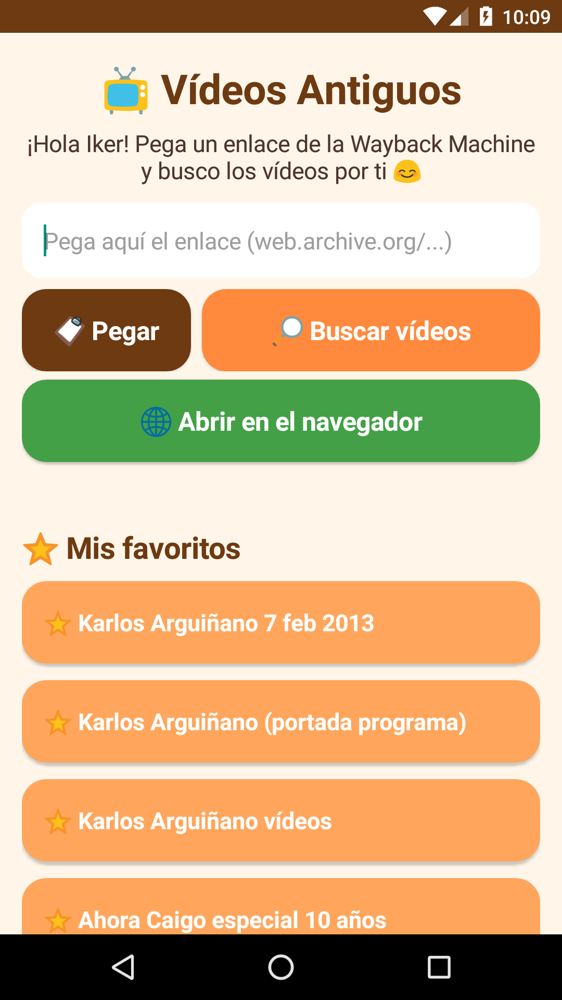
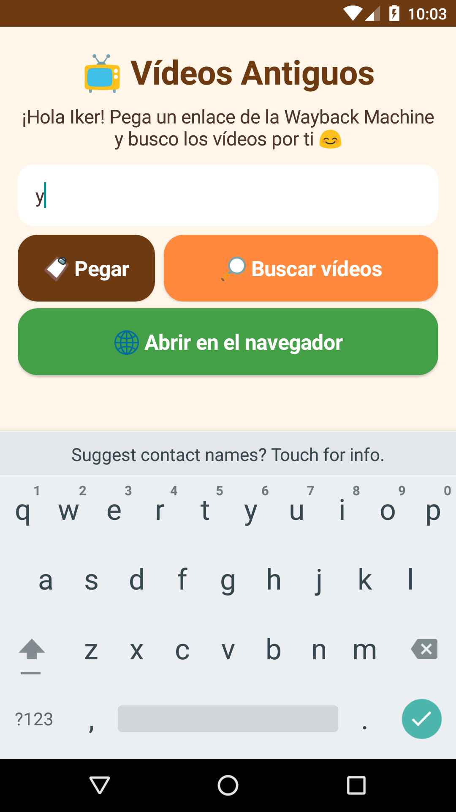
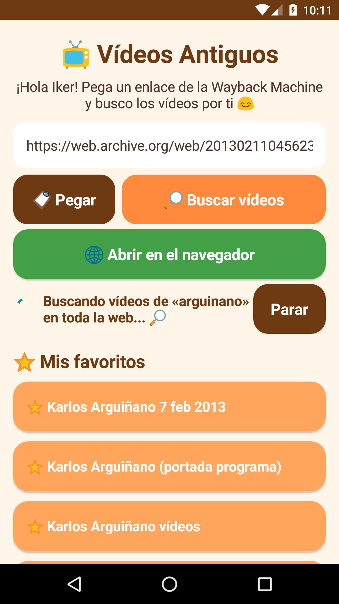
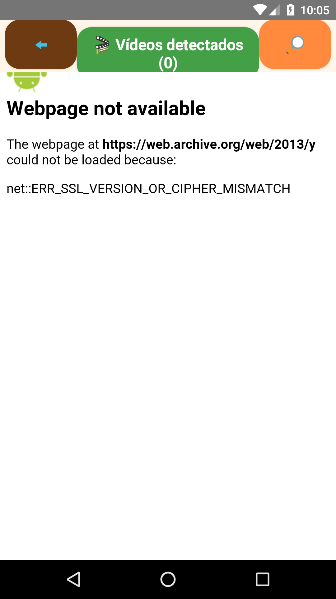

# 📺 Vídeos Antiguos

App Android para **buscar, ver y descargar programas de televisión antiguos guardados en la [Wayback Machine](https://web.archive.org/)** de archive.org.

## ¿Qué hace?

- **Buscar vídeos**: pegas un enlace de `web.archive.org/...` (o compartes uno desde otra app) y la app rastrea la página archivada buscando los vídeos guardados. Si no hay, sigue buscando por el resto de la web.
- **Ver**: reproduce los vídeos encontrados con el reproductor integrado.
- **Descargar**: guarda los vídeos en el móvil.
- **Navegador integrado**: abre la página archivada y detecta los vídeos que aparecen mientras navegas.
- **Favoritos** listos para usar: *Karlos Arguiñano* (Antena 3, 2013), *Ahora Caigo* (especial 10 años) y *Hogarutil* (Arguiñano cocina). Puedes añadir los tuyos con «➕ Guardar enlace en favoritos» y mantener pulsado uno para quitarlo.

## Capturas

| Inicio con favoritos | Buscando en la Wayback Machine | Buscando en la web | Navegador integrado |
|---|---|---|---|
|  |  |  |  |

*(Capturas hechas en un emulador sin acceso a archive.org, por eso el navegador muestra un error de conexión.)*

## Cómo instalar

1. En el móvil Android (5.0 o superior), descarga **`VideosAntiguos.apk`** desde la [página de versiones](../../releases/latest).
2. Ábrelo. Si Android lo pide, permite **«Instalar apps desconocidas»** para el navegador o el gestor de archivos.
3. Pulsa **Instalar** y abre **Vídeos Antiguos**.

## Compilar desde el código

Necesitas JDK 17 y el Android SDK (build-tools 34, platform android-34).

```bash
export KS_PASS='tu-contraseña'          # contraseña del keystore (no está en el repo)
export KS=/ruta/a/tu/keystore.jks       # si no existe, se crea uno nuevo
bash app/build.sh                       # genera VideosAntiguos.apk junto a app/
```

Los tests del extractor están en `app/test/`.
